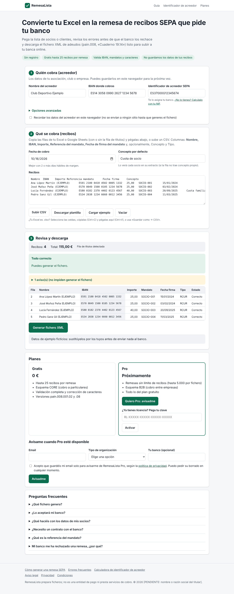

# RemesaLista

Convierte un Excel de socios o clientes en el **fichero XML de recibos SEPA** (ISO 20022 `pain.008`, «Cuaderno 19.14») que piden los bancos para cobrar cuotas por domiciliación. Antes de generarlo detecta los errores que harían que el banco lo rechace.

> **Estado:** MVP funcional y probado en local. **No está publicado, no tiene usuarios ni ingresos.** Ver `PROGRESS.md`.



## Qué hace
- Lee datos pegados desde Excel o Google Sheets, o un CSV (UTF-8 o Windows-1252), y reconoce las columnas por sus títulos.
- Valida:
  - IBAN (incluidos los dígitos internos españoles);
  - BIC;
  - identificador de acreedor (AT-02);
  - importes en formato español o inglés (rechaza los ambiguos);
  - fechas y referencias de mandato;
  - el juego de caracteres SEPA.

  Cada error se explica en castellano, indicando fila y campo.
- Genera `pain.008.001.02` o `.08`, comprobados contra los XSD oficiales.
- Ofrece una calculadora del identificador de acreedor a partir del NIF o CIF.
- Plan gratuito (≤ 25 recibos y CORE) y plan Pro por licencia (≤ 5.000 recibos y B2B). Los límites se aplican **en el servidor**.
- Automatizaciones:
  - pago en Stripe → webhook verificado → licencia → correo (con reintentos y alertas);
  - caducidad y recordatorios de licencias;
  - limpieza de datos temporales;
  - copia de seguridad diaria;
  - informe diario al administrador.
- Privacidad: los datos de las remesas no se guardan. No usa cookies ni analítica de terceros.

## Requisitos
- Node.js ≥ 22.13. No hay dependencias de producción.
- Para las pruebas: `xmllint` y, para las E2E, Chromium (`CHROMIUM_PATH`).

## Uso
```bash
npm install
npm start                      # http://localhost:3000
npm test                       # unitarias + integración (70)
npm run test:e2e               # navegador real (10)
npm run license -- issue --email cliente@ejemplo.es --days 365   # requiere APP_SECRET
npm run preflight              # comprueba la configuración de producción
npm run worker:once            # ejecuta las tareas programadas pendientes (cron externo)
npm run score                  # recalcula la puntuación de oportunidades
```
Configuración: `.env.example`. Despliegue: `DEPLOYMENT.md`.

## API
| Método y ruta | Uso |
|---|---|
| `POST /api/generate` | `{remittance, version: "02"/"08", licenseKey?}` → `{ok, xml, filename, summary, warnings}`. 422 con `errors` si hay errores de validación. |
| `POST /api/license/verify` | `{key}` → `{valid, plan, expiresAt}` |
| `POST /api/interest` | Lista de espera (`email`, `consent: true`) |
| `POST /api/event` | Contador de embudo (lista blanca, sin datos personales) |
| `POST /api/webhooks/stripe` | Webhook firmado de Stripe |
| `GET /api/config` | Límites y disponibilidad de Pro |
| `GET /healthz` | Salud (detalle con `Authorization: Bearer $HEALTH_TOKEN`) |

## Estructura
```
src/sepa/      núcleo SEPA (isomórfico; xml.js solo en el servidor)
src/server/    HTTP, BD, licencias, Stripe, correo, límites
src/worker/    planificador y tareas programadas
public/        interfaz, guías, legal, sitemap
scripts/       CLI de licencias, preflight, puntuación, oráculo stdnum
test/          pruebas (node:test) y e2e/ (Chromium)
deploy/        systemd + Caddy para VPS
```

## Documentación
| Documento | Contenido |
|---|---|
| [RESEARCH.md](RESEARCH.md) | Fuentes y análisis de mercado |
| [OPPORTUNITIES.md](OPPORTUNITIES.md) | Comparación y decisión |
| [BUSINESS_PLAN.md](BUSINESS_PLAN.md) | Público, monetización y economía |
| [EXPERIMENTS.md](EXPERIMENTS.md) | Hipótesis y umbrales |
| [ROADMAP.md](ROADMAP.md) | Próximos pasos |
| [PROGRESS.md](PROGRESS.md) | Estado real |
| [COSTS.md](COSTS.md) | Costes |
| [TECHNICAL_DECISIONS.md](TECHNICAL_DECISIONS.md) | Decisiones de arquitectura |
| [SECURITY.md](SECURITY.md) | Seguridad |
| [DEPLOYMENT.md](DEPLOYMENT.md) | Despliegue |

## Licencias de terceros
- Los esquemas XSD de `test/fixtures/xsd/` son esquemas ISO 20022 tomados del paquete `sepaxml` (licencia MIT) y solo se usan en las pruebas.
- `scripts/crosscheck/` usa `python-stdnum` (LGPL) como oráculo de desarrollo; no forma parte del producto.
